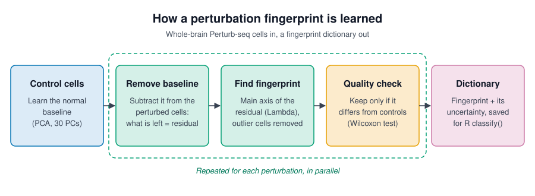
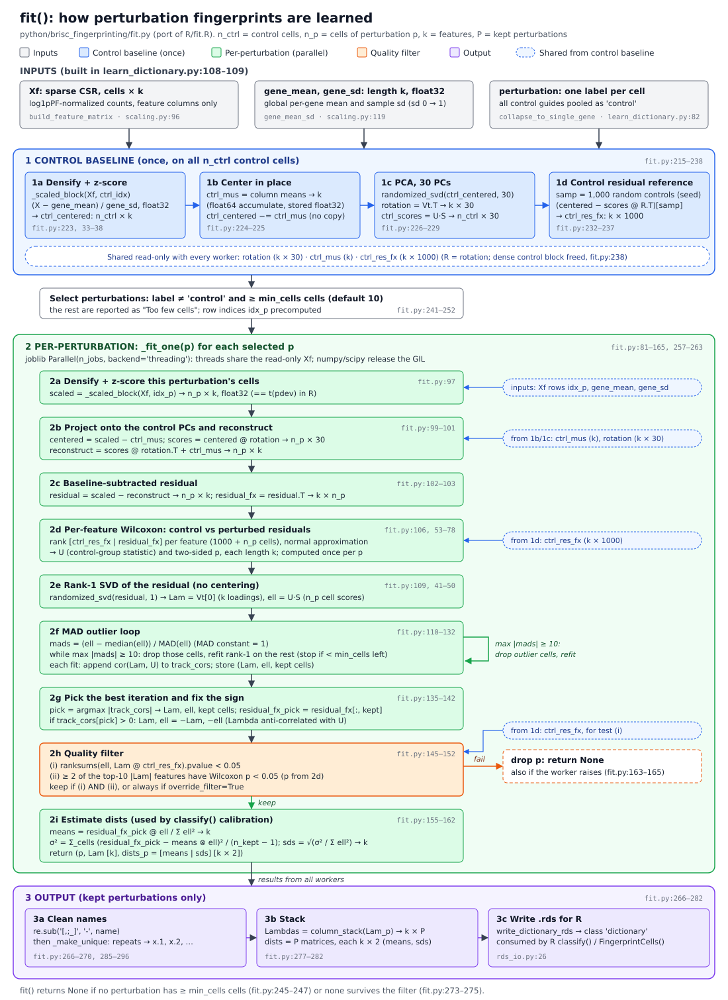

# `fit()` schematic: how fingerprints are learned

For a plain-language version of the whole pipeline, see [`pipeline_overview.md`](pipeline_overview.md).

## At a glance

Control cells define the normal baseline. For each perturbation, the baseline is removed, the main axis
of what remains becomes its fingerprint, and only fingerprints that differ from controls are kept. The
detailed diagram follows.

Source: [`python/brisc_fingerprinting/fit.py`](../../python/brisc_fingerprinting/fit.py), a port of
[`R/fit.R`](../../R/fit.R). Shapes: `n_ctrl` = control cells, `n_p` = cells of perturbation p,
`k` = features, `P` = kept perturbations. Line refs are into `fit.py` unless noted.

## Inputs (built by `learn_dictionary`, [learn_dictionary.py:108-109](../../python/brisc_fingerprinting/learn_dictionary.py#L108))

- `Xf`: sparse CSR, cells × k, log1pPF-normalized and restricted to the features
  ([scaling.py:96](../../python/brisc_fingerprinting/scaling.py#L96)).
- `gene_mean`, `gene_sd`: global per-gene mean and sample SD, length k, float32. Zero-SD genes get SD 1
  ([scaling.py:119](../../python/brisc_fingerprinting/scaling.py#L119)). They replace SCTransform `scale.data`:
  each cell subset is z-scored when it is needed.
- `perturbation`: one label per cell. All control guides are pooled as `'control'`
  ([learn_dictionary.py:82](../../python/brisc_fingerprinting/learn_dictionary.py#L82)).

## 1. Control baseline (once) — [fit.py:215-238](../../python/brisc_fingerprinting/fit.py#L215)

1. **1a Densify + z-score.** `_scaled_block(Xf, ctrl_idx, ...)` returns a float32 `n_ctrl × k` block,
   `(X − gene_mean) / gene_sd` ([fit.py:223](../../python/brisc_fingerprinting/fit.py#L223),
   [33-38](../../python/brisc_fingerprinting/fit.py#L33)).
2. **1b Center in place.** `ctrl_mus` holds the column means (accumulated in float64, stored as float32,
   length k). They are subtracted in place, so only one dense copy exists
   ([fit.py:224-225](../../python/brisc_fingerprinting/fit.py#L224)).
3. **1c PCA.** `randomized_svd(..., 30)` gives `rotation = Vt.T` (k × 30) and
   `ctrl_scores = U·S` (n_ctrl × 30) ([fit.py:226-229](../../python/brisc_fingerprinting/fit.py#L226)).
   This matches `prcomp_irlba(t(ctrl.pdev), n=30)`.
4. **1d Control residual reference.** Take 1,000 seeded random controls (all of them if there are
   ≤ 1,000). `ctrl_res_fx = (centered − scores @ rotation.T)[samp].T` is k × 1000
   ([fit.py:232-237](../../python/brisc_fingerprinting/fit.py#L232)). The dense control block is then freed
   ([fit.py:238](../../python/brisc_fingerprinting/fit.py#L238)).

**Selection.** Only non-control labels with ≥ `min_cells` cells (default 10) are processed. The others
are reported as "Too few cells" ([fit.py:241-252](../../python/brisc_fingerprinting/fit.py#L241)).

## 2. Per-perturbation loop — `_fit_one`, [fit.py:81-165](../../python/brisc_fingerprinting/fit.py#L81)

The loop runs through joblib `Parallel(n_jobs, backend="threading")`. Threads share the read-only `Xf`
([fit.py:257-263](../../python/brisc_fingerprinting/fit.py#L257)).

1. **2a Densify + z-score** p's cells: `scaled` is n_p × k, float32
   ([fit.py:97](../../python/brisc_fingerprinting/fit.py#L97)).
2. **2b Project and reconstruct.** `scores = (scaled − ctrl_mus) @ rotation` is n_p × 30, and
   `reconstruct = scores @ rotation.T + ctrl_mus` is n_p × k
   ([fit.py:99-101](../../python/brisc_fingerprinting/fit.py#L99)).
3. **2c Residual.** `residual = scaled − reconstruct` is n_p × k, and `residual_fx = residual.T` is k × n_p
   ([fit.py:102-103](../../python/brisc_fingerprinting/fit.py#L102)).
4. **2d Wilcoxon per feature.** This compares `ctrl_res_fx` with `residual_fx` and returns the
   control-group U and a two-sided p, each of length k. It uses a normal approximation without the tie
   term ([fit.py:106](../../python/brisc_fingerprinting/fit.py#L106),
   [53-78](../../python/brisc_fingerprinting/fit.py#L53)). It is computed once per perturbation.
5. **2e Rank-1 SVD**, without centering: `Lam = Vt[0]` (k) and `ell = U·S` (n_p)
   ([fit.py:109](../../python/brisc_fingerprinting/fit.py#L109), [41-50](../../python/brisc_fingerprinting/fit.py#L41)).
6. **2f MAD outlier loop.** `mads = (ell − median) / MAD` uses constant 1. While `max|mads| ≥ 10`, the
   outlier cells are dropped and rank-1 is refit on the rest. The loop stops if fewer than `min_cells`
   cells remain. Each fit appends `cor(Lam, U)` to `track_cors`
   ([fit.py:110-132](../../python/brisc_fingerprinting/fit.py#L110)).
7. **2g Pick + sign.** `pick = argmax|track_cors|`. If `track_cors[pick] > 0`, `Lam` and `ell` are
   negated, so Lambda is anti-correlated with U. `residual_fx` is restricted to the kept cells
   ([fit.py:135-142](../../python/brisc_fingerprinting/fit.py#L135)).
8. **2h Quality filter.** A perturbation is kept when both tests pass:
   (i) `ranksums(ell, Lam @ ctrl_res_fx).pvalue < 0.05`;
   (ii) ≥ 2 of the top-10 |Lam| features have Wilcoxon p < 0.05 (the p from 2d).
   Otherwise it returns `None`, unless `override_filter=True`
   ([fit.py:145-152](../../python/brisc_fingerprinting/fit.py#L145)). Any exception also drops it
   ([fit.py:163-165](../../python/brisc_fingerprinting/fit.py#L163)).
9. **2i Dists.** `means = residual_fx_pick @ ell / Σell²`,
   `σ² = Σ_cells(residual − means⊗ell)² / (n_kept − 1)` and `sds = √(σ² / Σell²)`. Together they give
   `dists_p`, a k × 2 matrix of `[means, sds]` ([fit.py:155-162](../../python/brisc_fingerprinting/fit.py#L155)).

## 3. Output — [fit.py:266-282](../../python/brisc_fingerprinting/fit.py#L266)

1. **3a Names.** `[,;_]` is replaced by `-`, then `_make_unique` gives R `make.unique` semantics
   ([fit.py:266-270](../../python/brisc_fingerprinting/fit.py#L266), [285-296](../../python/brisc_fingerprinting/fit.py#L285)).
   Python cleans only the kept names. R cleans every name before filtering. The kept names are the same.
2. **3b Stack.** `Lambdas` is k × P, and `dists` is a list of P matrices, each k × 2
   ([fit.py:277-282](../../python/brisc_fingerprinting/fit.py#L277)).
3. **3c Write.** `write_dictionary_rds` saves a `dictionary`-class `.rds`
   ([rds_io.py:26](../../python/brisc_fingerprinting/rds_io.py#L26)). R `classify()` / `FingerprintCells()`
   reads it.

`fit()` returns `None` in two cases: no perturbation has ≥ `min_cells` cells
([fit.py:245-247](../../python/brisc_fingerprinting/fit.py#L245)), or none passes the filter
([fit.py:273-275](../../python/brisc_fingerprinting/fit.py#L273)).
