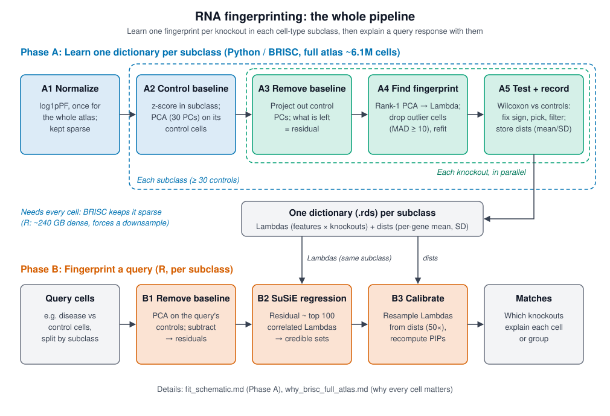

# RNA fingerprinting in plain terms (and where BRISC fits)

Start here if you have not seen the method before. This page explains what the pipeline does and why
it is so memory-hungry. [`why_brisc_full_atlas.md`](why_brisc_full_atlas.md) gives the case for
BRISC, and [`fit_schematic.md`](fit_schematic.md) has the line-by-line detail.

## The question

You have a transcriptional response you want to explain, for example disease cells compared with
control cells. You want to know **which gene knockouts produce a response that looks like it.**

Perturb-seq gives the reference. Each of about 2,000 genes was knocked out in mouse brain cells, and
each cell was sequenced. From those cells we learn one **fingerprint** per knockout: the direction
in gene-expression space that the knockout pushes cells. We then ask which fingerprints, combined,
best explain the query response.

A knockout can do different things in different cell types. So, as the authors do, everything is done
**separately per cell-type subclass** (`predicted_subclass`, about 300 of them). Each subclass gets its
own controls, its own baseline and its own dictionary. A query astrocyte is matched against the
astrocyte dictionary, using query astrocytes as its controls.

## Two phases

| Phase | What it does | Data size | Where it runs |
|---|---|---|---|
| **A. Learn the dictionaries** (`LearnDictionary` → `fit()`, per subclass) | One fingerprint per knockout per subclass, plus its uncertainty | Whole atlas: ~6.1M QC cells | **Python / BRISC** (this port) |
| **B. Fingerprint a query** (`FingerprintCells` → `classify()`, per subclass) | Match each query subclass to its own dictionary | ~100k cells | R (unchanged) |

Phase A is the heavy part. Phase B only needs the finished dictionaries: one small `.rds` file of
features × knockouts per subclass.

## Phase A in five steps

Normalization (step 1) runs once on the whole atlas. Steps 2–5 then run once per subclass, on that
subclass's cells only. Subclasses with fewer than 30 control cells are skipped (the authors' threshold).

1. **Put every cell on the same scale.** Raw counts depend on sequencing depth and on how highly a
   gene is expressed. Normalization (log1pPF, then a per-gene z-score computed within the subclass)
   makes 1 unit mean the same thing for every gene. (R uses SCTransform for this step.)
2. **Learn what normal variation looks like.** Control cells (no knockout, `Negative` guides) of the
   subclass still vary, by brain region and cell state. A 30-component PCA on those controls captures
   this baseline variation.
3. **Remove the baseline from each knockout's cells.** Each knocked-out cell is projected onto the
   control PCs, and the part they explain is subtracted. The leftover **residual** is the part of
   that cell that normal variation cannot explain.
4. **Find the main leftover direction.** A rank-1 PCA on one knockout's residuals gives the single
   gene direction that best explains them. That direction is the fingerprint (**Lambda**), and each
   cell's score along it is **ell**. A few cells can dominate this fit, for example doublets or very
   strong responders. Those outlier cells are dropped iteratively (the **MAD** rule) and the fit is
   redone.
5. **Keep only real fingerprints and record their uncertainty.** Wilcoxon tests against control
   residuals do three jobs. They fix the fingerprint's sign, which PCA leaves arbitrary. They choose
   the best candidate among the outlier-removal iterations. They drop knockouts that look no
   different from controls. For each kept knockout we store a mean and SD per gene (**dists**),
   which say how precisely each entry of the fingerprint is known.

## Phase B in three steps

These run per query subclass, using the dictionary of the same subclass.

1. Remove the control baseline from the query cells. This uses the same kind of control PCA as
   Phase A, run on the query's own control cells of that subclass.
2. Regress each query residual (one cell or one pooled group) on its top 100 most-correlated
   fingerprints with **SuSiE**. SuSiE returns a small set of fingerprints that explain the residual,
   as credible sets with probabilities.
3. **Calibrate.** Draw 50 resampled dictionaries from the `dists` (mean ± SD per gene), then recompute
   the probabilities. A fingerprint whose entries are poorly known gets less confident assignments.

## Where the memory wall is

Step A1 in R (SCTransform) produces `scale.data`, a **dense** matrix with one float per gene per cell.
Single-cell counts are about 90% zeros and are cheap to store sparse, but scaled values are almost
never zero. At 6.1M cells × 5k features in float64 that is about 240 GB before `fit()` copies any of
it, so R can only run on a subsample (about 500k cells).

BRISC loads and normalizes the atlas once and keeps the counts **sparse**. For each subclass it
copies out only that subclass's rows, computes a per-gene mean and SD, and `fit()` builds a dense,
scaled block only for the cells it needs at that moment: the subclass's controls once, then one
knockout at a time. The full atlas then fits on one large-memory node, and **every subclass
dictionary sees every cell of that subclass.**

## Why the cell count matters

Steps A2–A5 all estimate something from cells, and every one of those estimates gets better with
more cells. The bottleneck is cells per knockout *within a subclass*. Splitting about 2,000 cells per
knockout across subclasses leaves most knockout × subclass pairs with (we expect) tens to hundreds of cells, even
on the full atlas. A 10x downsample would push most of them below the 10-cell minimum. Splitting by
subclass is the reason every cell matters.
[`why_brisc_full_atlas.md`](why_brisc_full_atlas.md#why-each-step-needs-cells) goes through each step.

## Glossary

| Term | Meaning |
|---|---|
| Subclass | Allen Brain Atlas cell type (`predicted_subclass`). One dictionary per subclass. |
| Control | Cells with no targeting guide (`Negative`, `Non_target`, `Safe_target_*`). They define "normal" within a subclass. |
| Baseline / control PCs | The 30 main axes of variation among controls. |
| Residual | A cell's expression minus what the control PCs predict for it. |
| Lambda / fingerprint | A knockout's characteristic gene direction (one value per feature). |
| ell | Each cell's score along its knockout's Lambda (response strength). |
| MAD | Median absolute deviation, a robust spread measure used to flag outlier cells. |
| dists | A per-gene mean and SD for each Lambda, used to calibrate Phase B. |
| SuSiE | Sparse regression that picks a few fingerprints and reports how confident it is. |
