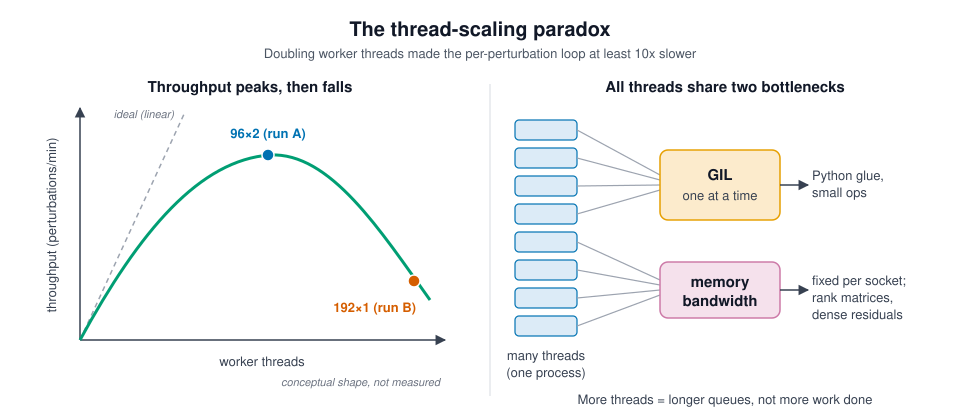

# The thread-scaling paradox

## TL;DR

- Doubling the worker threads in `fit()`'s per-perturbation loop (96 to 192) made it **at least 10× slower**, not 2× faster.
- Our best explanation: all threads share two bottlenecks, Python's GIL and memory bandwidth. Past a point, adding threads only adds queueing and contention.
- Fix: do less shared work per task (a precomputed-control Wilcoxon), then benchmark a sweep of thread counts. Until then we run 96×2.

## What we saw

Measured 2026-10-14 on one Trillium node (192 cores, 2 sockets, 12 memory channels per socket, about 745 GiB). Test data: a two-file subset with 432k cells, 11,796 genes and 1,946 perturbations. The timings cover the per-perturbation loop in `fit()` ([fit.py](../../python/brisc_fingerprinting/fit.py)).

| Run | joblib threads × BLAS threads | First 10% (194 perturbations) | Projected loop time | Peak memory |
|---|---|---|---|---|
| A | 96 × 2 | 1 min 51 s | about 16 min | 65 GB |
| B | 192 × 1 (via `threadpool_limits`) | not reached after 20 min (cancelled) | at least 10× slower | 118 GB |

All other steps (load, normalize, control PCA) took under 1 minute in total, so the loop is the only bottleneck.

## Why

The loop runs `_fit_one` once per perturbation, using joblib's `Parallel(backend="threading")`. Each task:

1. densifies the perturbation's rows and projects out the control PCs;
2. runs `_wilcox_per_feature`, which concatenates 1,000 control residuals with the n_p perturbed ones and re-ranks all 11,796 genes with `scipy.stats.rankdata`. This creates float32 ranks plus int64 sort-index temporaries: about 57 MB for the rank matrix per call, and several hundred MB of memory traffic in total;
3. runs a rank-1 randomized SVD, repeated inside the MAD outlier loop;
4. runs many small Python-level steps between these.

Our best explanation (not yet profiled):

**1. The GIL.** Every worker is a thread inside one Python process. Large numpy and LAPACK calls release Python's global interpreter lock (GIL), so they run truly in parallel. The glue code and small operations need the GIL, and only one thread can hold it at a time. More threads mean longer queues for the GIL, more context switches and more cache thrashing.

**2. Memory bandwidth and cache.** Each task's working set is far larger than the CPU cache, and bandwidth per socket is fixed. Memory-heavy work saturates that bandwidth well below 192 cores. Extra threads then wait for memory instead of computing.

**3. The BLAS = 1 effect.** Run B also cut BLAS to 1 thread per worker. That moved work out of the part that parallelizes well (GIL-released BLAS) and doubled the number of threads competing in the part that doesn't (GIL-bound glue and the bandwidth-bound ranking).

One caveat: progress is logged in input order, so a slow early task can delay the 10% milestone. That cannot explain a gap this large.

## The general principle: retrograde scaling

Amdahl's law says the serial fraction of a job caps its speedup: if some work must happen one thread at a time (here, GIL-held code), extra threads cannot speed that part up. Contention costs (lock queues, cache misses, memory traffic) also *grow* with the worker count. Together these give a throughput curve that rises, peaks and then **declines**. This is called retrograde scaling. Gunther's Universal Scalability Law is the standard model of this shape. Run A sits near the peak; run B is on the falling side.

## What we learn

- **The shared bottleneck sets the speed, not the core count.**
- **"Max out the threads" is a hypothesis, not a default.** Benchmark a sweep (16 / 32 / 64 / 96 / 192 workers) on a fixed subset of about 200 perturbations and pick the peak.
- **The fix is less shared work per task, not more workers.**

## What we're doing about it

**(i) Precomputed-control Wilcoxon.** The 1,000 control residuals are the same for every perturbation, yet we re-rank them every time. Instead: sort the control residuals per gene **once**. For each perturbation, sort only its own values and use `np.searchsorted` to count pairs. The Mann-Whitney U is the number of (control, perturbed) pairs where control > perturbed, with ties counted as ½. This is mathematically identical to the rank-sum U and needs no combined matrix or rank matrix.

Worked example: controls `[0.1, 0.5, 0.9]`, perturbed `[0.3, 0.7]`.

- Pair-counting: for each control, count the perturbed values below it: 0.1 → 0, 0.5 → 1, 0.9 → 2. Counts 0, 1, 2 give U = 3 pairs where control > perturbed (0.5 > 0.3, 0.9 > 0.3, 0.9 > 0.7).
- Rank-sum: the pooled order is 0.1, 0.3, 0.5, 0.7, 0.9, so the controls have ranks 1, 3, 5 and R1 = 9. Then U = R1 − n1(n1+1)/2 = 9 − 6 = **3**. Same answer.

**(ii) Optional: process-based workers.** joblib's `loky` backend with shared memory would give each worker its own Python interpreter and so escape the GIL.

**(iii) Thread-count sweep.** Run settings revert to 96×2 until the sweep picks the best value.

**Why it matters.** On the full atlas each perturbation has about 14× more cells, so at the current rate the loop would take hours.
